<p align="center">
  <a href="https://github.com/cineva-stream/Cineva">
    <picture>
      <source media="(prefers-color-scheme: dark)" srcset="public/logo_cineva.png" />
      <source media="(prefers-color-scheme: light)" srcset="public/logo_cineva_light.png" />
      
    </picture>
  </a>
</p>

<p align="center">
  <strong>Official Web Portal and Landing Platform for the Cineva Streaming Ecosystem</strong>
</p>

<p align="center">
  <a href="https://github.com/cineva-stream/Cineva"></a>
  
  
  
  
</p>

---

## Connected Repositories

This repository represents the official web portal, distribution showcase, and documentation platform for the Cineva application ecosystem.

| Project | Repository | Description |
| :--- | :--- | :--- |
| **Main Application** | [cineva-stream/Cineva](https://github.com/cineva-stream/Cineva) | High-performance Flutter Android application for streaming and offline media management |
| **Web Portal** | [cineva-stream/cineva-web](https://github.com/cineva-stream/cineva-web) | Next.js landing portal, feature showcase, legal documentation, and distribution site |
| **Release APK** | [Cineva Android APK Releases](https://github.com/cineva-stream/Cineva/releases) | Official Android installation binaries and changelog history |

---

## About Cineva Web

Cineva Web is the official presentation, distribution, and documentation portal engineered to showcase the Cineva streaming ecosystem. Built using Next.js 14 (App Router), React 18, and TypeScript, the web platform delivers a cinematic, highly responsive user experience echoing the mobile application's Deep Obsidian aesthetic and Cinema Amber lighting without relying on heavy third-party CSS frameworks.

The site provides an immersive overview of Cineva capabilities, interactive installation pathways, synchronized legal documentation (Terms of Use, Privacy Policy, and DMCA Disclaimer), and direct access to production release binaries.

---

## Key Features

- **Cinematic Marquee and Visual Showcase**
  Four-column dynamic poster marquee highlighting global movie releases with linear gradient fading and floating smartphone mockups.

- **Interactive Scrollytelling Tour**
  Synchronized section-by-section feature walkthrough (Home, Search, Watchlist, Subtitle Customizer, and Profile) with sticky mobile mockup transitions.

- **Multi-Method Installation Guides**
  Interactive guide detailing multiple Android installation pathways, including direct APK installation, ADB sideloading commands, and compiling from source code.

- **Synchronized Legal Documentation**
  Full-screen editorial markdown layouts for Terms of Service (/syarat-penggunaan), Privacy Policy (/kebijakan-privasi), and DMCA Disclaimer (/disclaimer), maintained in alignment with the Android application.

- **Zero-Dependency Styling and High Performance**
  Pure modern CSS custom properties and design tokens ensuring minimal bundle overhead, maximum rendering speed, and fluid cross-browser rendering.

- **Comprehensive SEO and Metadata**
  Automated Open Graph image generation, Twitter card integration, JSON-LD structured data for FAQ queries, and complete multi-format favicon suites.

---

## Technology Stack

| Layer | Technology |
| :--- | :--- |
| **Framework** | Next.js 14 (App Router) |
| **UI Library** | React 18 |
| **Language** | TypeScript (Strict Mode) |
| **Styling** | Vanilla CSS (CSS Variables, Flexbox, CSS Grid) |
| **Typography** | Google Fonts (Self-hosted Outfit, Inter, JetBrains Mono) |
| **Asset Delivery** | WebP responsive image optimization |

---

## Project Structure

```text
cineva-web/
├── app/
│   ├── disclaimer/          # DMCA and copyright disclaimer page
│   ├── kebijakan-privasi/   # Privacy policy documentation page
│   ├── syarat-penggunaan/   # Terms and conditions page
│   ├── globals.css          # Design system, CSS variables, and layout styles
│   ├── layout.tsx           # Root layout and global SEO metadata
│   └── page.tsx             # Main landing page composition
├── components/
│   ├── CtaBanner.tsx        # Call-to-action banner with poster background
│   ├── Footer.tsx           # Multi-column navigation and legal links
│   ├── Hero.tsx             # Hero section with poster marquee and device mockups
│   ├── Icons.tsx            # Inline SVG icons
│   ├── InstallTabs.tsx      # Multi-platform installation guide tabs
│   ├── LegalLayout.tsx      # Editorial layout for legal documentation
│   ├── Navbar.tsx           # Floating glassmorphism navigation bar
│   ├── Section.tsx          # Consistent section layout container
│   └── Showcase.tsx         # Interactive scrollytelling feature showcase
├── lib/
│   ├── content.ts           # Site text content, feature lists, and metadata
│   └── legal.ts             # Canonical legal terms, privacy, and disclaimer text
├── public/
│   ├── posters/             # High-resolution poster assets (.webp)
│   ├── screens/             # Official Cineva Android application screenshots (.webp)
│   ├── Cineva_transparent.png # Transparent Cineva branding asset
│   ├── logo_cineva.png      # Cineva dark theme logo
│   ├── logo_cineva_light.png # Cineva light theme logo
│   └── favicon.ico          # Browser favicon
├── package.json
└── tsconfig.json
```

---

## Getting Started Locally

### Prerequisites

Ensure the following tools are installed on your machine:
- Node.js version 18.17.0 or higher
- npm, yarn, or pnpm package manager

### Local Development Setup

1. **Clone the repository:**
   ```bash
   git clone https://github.com/cineva-stream/cineva-web.git
   cd cineva-web
   ```

2. **Install dependencies:**
   ```bash
   npm install
   ```

3. **Run the local development server:**
   ```bash
   npm run dev
   ```
   Open your browser and navigate to http://localhost:3000.

4. **Build for production:**
   ```bash
   npm run build
   npm run start
   ```

---

## Can I Contribute?

Yes, absolutely. Contributions to Cineva Web are warmly welcomed and strongly encouraged.

Whether you wish to refine user interface responsiveness, polish animations, optimize Lighthouse performance metrics, expand accessibility (a11y) support, enhance internationalization, or update documentation, your contributions are highly appreciated.

To contribute:
1. Fork the repository.
2. Create a topic branch (`git checkout -b feature/your-improvement`).
3. Commit your changes with clear, concise commit messages.
4. Ensure the project builds cleanly without TypeScript or linting errors (`npm run build`).
5. Open a Pull Request detailing your enhancements and testing results.

---

## License

This project is open-source software licensed under the **GNU General Public License v3.0 (GPL-3.0)**.

Please read the [LICENSE](LICENSE) file located in the root directory of this repository for the full terms and conditions regarding usage, redistribution, and modification.

---

## Disclaimer

Cineva and Cineva Web are open-source software utilities. All movie metadata, poster artworks, synopsis texts, and related media assets referenced on this platform are the property of their respective production studios, copyright owners, and distributors (supported via TMDB API).

To review our complete legal terms, please visit:
- [Terms of Use](/syarat-penggunaan)
- [Privacy Policy](/kebijakan-privasi)
- [DMCA Disclaimer](/disclaimer)

---

## Maintainers

Developed and maintained by the **Cineva Group**.
